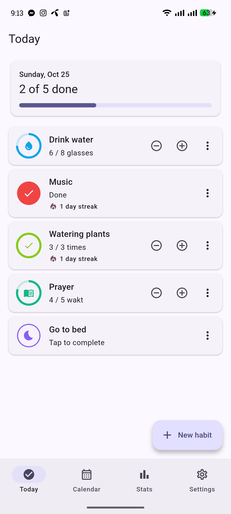
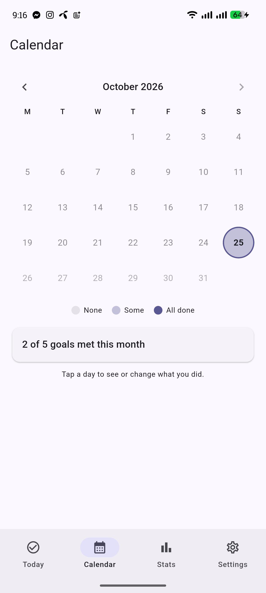
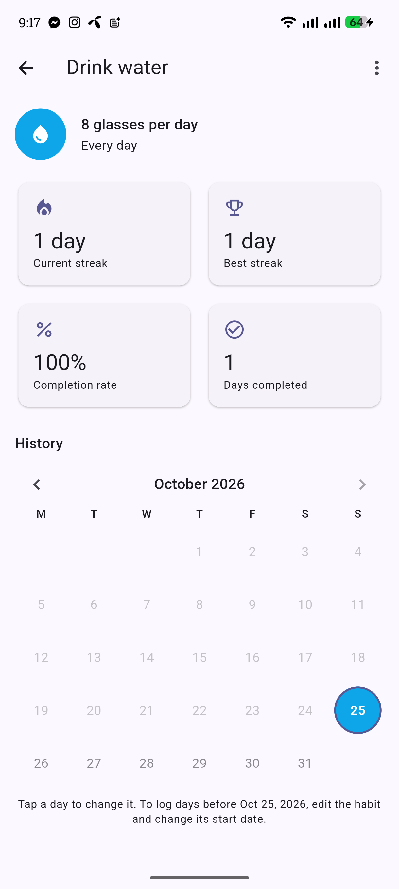
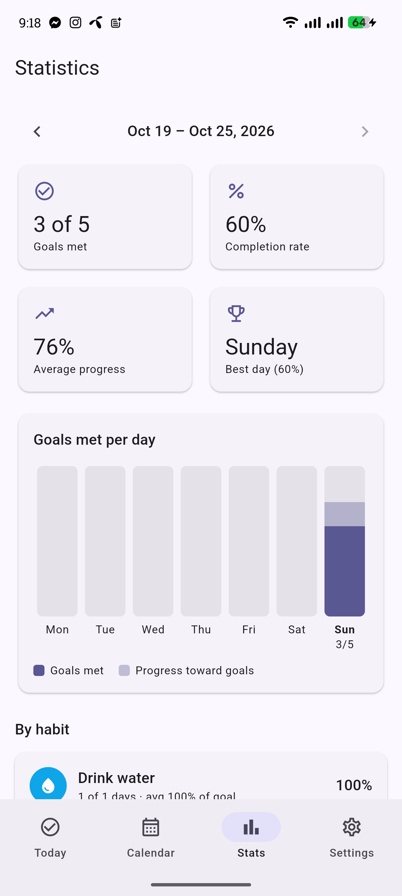
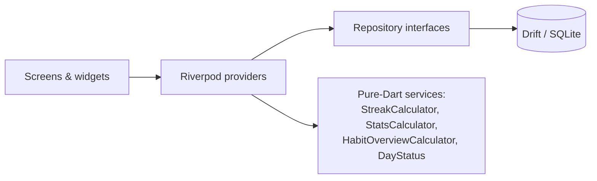

# HabitFlow

A modern, **offline-first habit tracker** for Android and iOS, built with
Flutter. Track simple check-off habits and counted goals ("8 glasses of
water"), keep streaks, browse your history, and see weekly statistics.

<p>
  
  
  
  
</p>

## Features

- **Two kinds of habits, one model:** a check habit is just a goal of 1;
  counted habits have a goal, unit and step (`+` / `-`, or long-press to type
  an exact value).
- **Flexible schedules:** pick the weekdays a habit applies to.
- **Streaks:** current and best, computed from history (never stored, so they
  can't go stale).
- **History calendar:** every day shaded by how many goals you met; tap any
  past day to review or fix it.
- **Habit detail:** streaks, completion rate, and a per-habit month calendar.
- **Weekly statistics:** goals met per day, average progress, best day, and a
  per-habit breakdown, with week-to-week navigation.
- **Archive / delete with undo**, custom start dates (log days from before you
  created the habit), light / dark / system theme, configurable week start.
- **Accessible:** semantic labels, 48dp targets, large-text tested, respects
  the system "remove animations" setting.

## Design decisions

| Decision | Why |
|---|---|
| **Local database is the source of truth** (Drift / SQLite) | Works fully offline and makes cloud sync an add-on layer rather than a rewrite. |
| **UUID ids, `updatedAt`, soft deletes** from day one | Exactly what a future sync engine needs, so no painful migration later. |
| **Dates are local calendar strings** (`yyyy-MM-dd`), not UTC timestamps | Avoids the classic midnight / timezone / DST bugs in habit apps. |
| **Each entry stores a snapshot of the goal** | Raising "8 glasses" to "10" doesn't rewrite last month's history or break streaks. |
| **Streaks are computed, not stored** | Editing a past day instantly produces the correct streak. |
| **Unfinished today never breaks a streak** | You haven't failed yet; only past scheduled days count as misses. |
| **Domain logic is pure Dart** | Streaks and stats are unit-tested without Flutter or a database. |

## Architecture



```
lib/
  app/        app widget, router, theme, providers
  core/       date utils, shared widgets, helpers
  data/       Drift database + repository implementations
  domain/     models, repository interfaces, pure-Dart services
  features/   today, calendar, habit_form, habit_detail, stats, settings, archived
```

**Stack:** Flutter, Riverpod (`Notifier` / `StreamProvider`, no code
generation), Drift, go_router, shared_preferences, intl, uuid.

## Testing

Unit tests cover the streak, statistics and day-status rules (including edge
cases like unscheduled days, partial progress, goal changes and month
boundaries). Repository tests run against an in-memory SQLite database, and
widget tests use in-memory fakes.

```bash
flutter test
```

CI (GitHub Actions) runs analyze + tests + an Android build, and builds the
iOS target on a macOS runner.

> **iOS note:** the iOS build is verified in CI (`flutter build ios
> --no-codesign`) but has **not been tested on a physical iPhone**.

## Run it

```bash
flutter pub get
dart run build_runner build      # generates the Drift code
flutter run
```

## Known limitations

- A habit's current schedule is applied to its whole history (schedule edits
  aren't versioned).
- Counted values aren't additive, so when cloud sync arrives, two offline
  devices editing the same day resolve last-write-wins.

## Roadmap

- [ ] Local reminders
- [ ] Firebase Authentication (email, Google)
- [ ] Cloud sync (Firestore) with conflict handling
- [ ] Store release (icons, privacy policy, signing)

## License

MIT, see [LICENSE](LICENSE).
